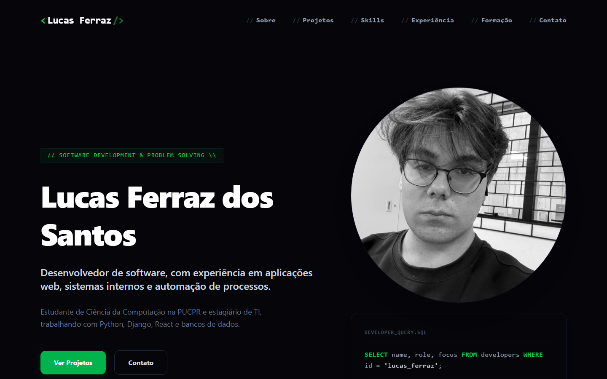

# Portfólio - Lucas Ferraz dos Santos

Portfólio pessoal com minha trajetória, projetos, experiência profissional e
conhecimentos técnicos. Cada projeto é apresentado com o contexto, o problema,
o processo e o que aprendi com ele.

🌐 **Acesse:** https://ferrazdeveloper.com

## 📂 Seções

- **Início:** apresentação e foco atual
- **Quem eu sou:** trajetória na faculdade e no estágio
- **Projetos:** cards com filtro por categoria e painel de "processo e aprendizados"
- **Conhecimento técnico:** tecnologias e onde cada uma foi usada
- **Experiência profissional:** estágio de TI no Grande Oriente do Brasil - Paraná
- **Formação:** Ciência da Computação na PUCPR, cursos e certificações
- **Contato:** e-mail, LinkedIn, GitHub e WhatsApp

## 🚀 Tecnologias

- React 19
- Vite
- Tailwind CSS 4 (via `@apply` em CSS Modules)
- JavaScript
- Vercel Analytics

O visual segue um tema de terminal/SQL, com animações feitas em CSS.

## 🗂️ Estrutura

```
src/
├── assets/                 # imagens dos projetos, logos e foto de perfil
├── components/
│   ├── layout/Header.jsx   # navegação fixa e menu mobile
│   └── sections/           # uma pasta por seção (componente + .module.css)
├── App.jsx                 # ordem das seções
└── index.css               # estilos globais
```

O conteúdo de cada seção fica em um array no topo do próprio componente
(por exemplo, `PROJECTS` em `Projects.jsx` e `EXPERIENCES` em `Experience.jsx`).
Para adicionar um projeto, basta incluir um novo objeto no array.

## ▶️ Como executar

Clone o repositório:

```bash
git clone https://github.com/lucasferraz-dev/Portfolio-LucasDev.git
```

Entre na pasta:

```bash
cd Portfolio-LucasDev
```

Instale as dependências:

```bash
npm install
```

Execute o projeto:

```bash
npm run dev
```

O projeto estará disponível no endereço informado pelo Vite no terminal.

Para gerar a versão de produção:

```bash
npm run build
```

## 📌 Autor

Lucas Ferraz dos Santos

GitHub: https://github.com/lucasferraz-dev

LinkedIn: https://www.linkedin.com/in/lucas-ferraz-bcc

Portfólio: https://ferrazdeveloper.com

## 📸 Preview


